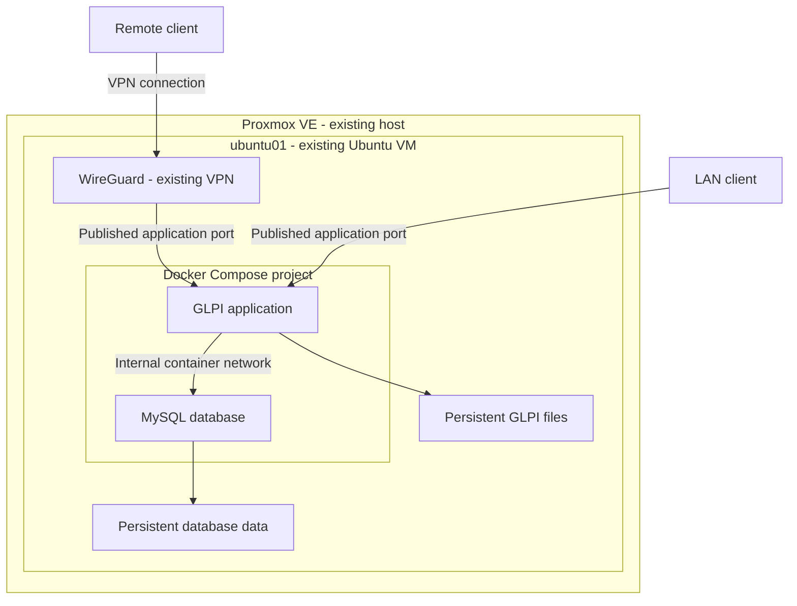

# Docker & Containers

> Part 4 of the IT-HomeLab Series
>
> This repository documents my Docker and container administration work in a practical HomeLab environment. The project focuses on deploying services, managing containers, working with persistent data, and troubleshooting common problems.
>
> **Status:** ✅ Completed
>
> **Note:** This repository covers **Part 4 – Docker & Containers**. Linux administration is covered in Part 3. Advanced operations, backup automation, monitoring, and security are planned for Part 5. The next practical project will focus on IT support and troubleshooting.

---

## Table of Contents

- [Project Overview](#project-overview)
- [Project Objectives](#project-objectives)
- [Technology Stack](#technology-stack)
- [Hardware & Environment](#hardware--environment)
- [Architecture](#architecture)
- [Repository Structure](#repository-structure)
- [Project Roadmap](#project-roadmap)
- [Project Timeline](#project-timeline)
- [Documentation Approach](#documentation-approach)
- [Next Project](#next-project)
- [IT-HomeLab Series](#it-homelab-series)

---

## Project Overview

In Part 3, I configured an Ubuntu Server and worked with Linux users, permissions, services, networking, SSH, WireGuard, and Active Directory integration.

In this project, I used the existing \ubuntu01 `server` to install Docker and work with container administration.

I started with Docker commands, container storage, and networking. I then used Docker Compose and Portainer to manage services and deployed GLPI with a MySQL database.

I tested container recreation, persistent data, network access, troubleshooting, and basic backups.

GLPI is now available as the ticket system for a separate **IT Support & Troubleshooting Lab**. This project provides the container environment for future support scenarios.

---

## Project Objectives

- Understand Docker images, containers, and the Docker Engine.
- Install Docker Engine and the Compose plugin.
- Manage the container lifecycle and inspect logs.
- Use volumes and bind mounts for persistent data.
- Configure container networks and published ports.
- Manage services with Docker Compose.
- Deploy GLPI and its database with persistent storage.
- Create basic backups of application files and database data, and check their integrity.
- Prepare the ticket system for practical IT support scenarios.

---

## Technology Stack

| Technology | Role | Status |
|:---|:---|:---|
| Proxmox VE | Virtualization platform | Existing |
| Ubuntu Server | Docker host | Existing |
| SSH & WireGuard | Administration and remote access | Existing |
| nftables | Host firewall and network access rules | Configured |
| Docker Engine | Run and manage containers | Installed & Verified |
| Docker Compose | Define and manage multi-container services | Installed & Tested |
| Portainer | Web-based container and stack management | Installed & Tested |
| Nginx | Container basics, storage, networking, and Compose practice | Tested |
| GLPI 11.0.12 | HomeLab ticket system | Deployed & Tested |
| MySQL 8.4 | Database for GLPI | Deployed & Tested |

---

## Hardware & Environment

| Component | Details |
|:---|:---|
| Physical host | Mini PC with AMD Ryzen 5 7430U |
| Host resources | 16 GB RAM, 512 GB SSD |
| Hypervisor | Proxmox VE |
| Docker host | Existing Ubuntu Server VM: `ubuntu01` |
| VM CPU | 2 vCPU |
| VM memory | 2–4 GiB with Proxmox memory ballooning |
| System filesystem | 30 GB, approximately 22 GB free |
| Additional storage | Approximately 24 GB mounted at `/srv/data` |
| Administration | SSH from MacBook |
| Service access | HomeLab LAN and existing WireGuard VPN |

Resource values are from the initial planning checks. Only a small number of containers will run at the same time.

---

## Architecture

The Ubuntu host, WireGuard, and Docker Engine are already in place. The GLPI and MySQL deployment shown below is complete.

Docker runs inside the existing `ubuntu01` VM on Proxmox.

GLPI and MySQL run in the same Docker Compose stack, managed through Portainer. They communicate over an internal Docker network, and MySQL has no published host port.

Both services use bind mounts under `/srv/data/glpi/` for persistent data. GLPI is accessible from the LAN and through WireGuard VPN. Access is controlled using the existing nftables firewall configuration.

The Ubuntu server also uses Active Directory authentication through SSSD. GLPI uses separate local accounts for the helpdesk tests.

---

## Repository Structure

| Path | Contents |
|:---|:---|
| `README.md` | Project overview, roadmap, and timeline |
| `docs/<phase>/README.md` | Configuration, tests, results, and lessons from each phase |
| `docs/<phase>/images/` | Selected screenshots |
| `docs/<phase>/` | Relevant Compose files and other configuration examples |

---

## Project Roadmap

This project was completed in five phases. The first four phases covered Docker fundamentals, persistent storage, networking, and Docker Compose. The final phase used these skills to deploy and test GLPI with MySQL.

### ✅ [Phase 1 – Docker Fundamentals, Installation & Container Basics](docs/1-Docker-Fundamentals-Installation-Container-Basics/README.md)

I installed Docker Engine and the Compose plugin, tested basic container commands, and ran an Nginx container. I also resolved a container network problem and verified SSH, WireGuard access, and container connectivity after reboot.

### ✅ [Phase 2 – Docker Persistent Storage & Portainer](docs/2-Docker-Persistent-Storage-Portainer/README.md)

I installed Portainer with a named volume for persistent data and a bind mount for Docker access. I accessed it from my MacBook through an SSH tunnel and recreated the container to verify that the administrator account and settings were preserved. Portainer remains available for future Docker administration tasks.

### ✅ [Phase 3 – Docker Networking](docs/3-Docker-Networking/README.md)

I created a user-defined bridge network and tested container name resolution and published ports. I resolved a firewall forwarding issue and verified access from the LAN and through WireGuard, including after a server reboot.

### ✅ [Phase 4 – Docker Compose](docs/4-Docker-Compose/README.md)

I managed Nginx with a Compose file, used environment variables and a read-only bind mount, and tested service management and container recreation. I verified that the web content remained available and checked an HTTP 404 error through the logs.

### ✅ [Phase 5 – GLPI Ticket System with Docker Compose](docs/5-GLPI-Ticket-System-with-Docker-Compose/README.md)

I deployed GLPI and MySQL using Docker Compose and Portainer, with persistent storage for application files and database data.

I configured requester and technician accounts, created ITIL categories, and tested a complete ticket workflow from creation to closure.

I verified data persistence after container recreation and a host reboot, checked resource usage, and created basic database and file backups. I also tested GLPI access from the LAN and through WireGuard VPN, including firewall restrictions.

GLPI is now available for future HomeLab support scenarios. These scenarios and their troubleshooting steps will be documented in a separate repository: [IT Support & Troubleshooting Lab][support-lab].

---

## Project Timeline

| Date | Milestone | Status |
|:---|:---|:---|
| 03-10-2026 | Initial resource and firewall checks; selected `ubuntu01` as the Docker host | ✅ Completed |
| 03-10-2026 | Repository overview and initial roadmap prepared | ✅ Completed |
| 06-10-2026 | GLPI selected; simplified five-phase roadmap drafted for review | ✅ Completed |
| 06-10-2026 | Phase 1 – Docker Fundamentals, Installation & Container Basics | ✅ Completed |
| 09-10-2026 | Phase 2 – Docker Persistent Storage & Portainer | ✅ Completed |
| 18-10-2026 | Phase 3 – Docker Networking | ✅ Completed |
| 22-10-2026 | Phase 4 – Docker Compose | ✅ Completed |
| 01-11-2026 | Phase 5 – GLPI Ticket System with Docker Compose | ✅ Completed |

---

## Documentation Approach

Each phase documents what I configured, why it was needed, how I tested it, and what I learned.

The documentation includes short explanations, relevant commands, useful screenshots, and troubleshooting results. Passwords, tokens, and sensitive connection details are not published.

---

## Next Project

The next practical step will be **IT Support & Troubleshooting Lab**, maintained in a separate GitHub repository.

I will use GLPI to record simulated user incidents and requests, investigate them in the HomeLab, verify the solution, and close the ticket. Examples include shared-folder access problems, locked accounts, DNS failures, printing problems, and stopped services.

Each case will include the ticket summary, symptoms, checks, cause, solution, and verification. Screenshots will show useful evidence, and all cases will be clearly labelled as HomeLab simulations.

This Docker repository will document installation and configuration. The support repository will document the investigations and solutions.

**Part 5 – Linux Operations** remains planned for deeper work on backup, monitoring, logging, security, and maintenance. It is not a requirement for starting the support lab; operational work can follow needs found during the scenarios.

---

## IT-HomeLab Series

This repository is Part 4 of my IT-HomeLab Series.

Each repository focuses on a different area of IT administration while remaining part of the same connected HomeLab environment.

| Part | Focus | Status | Repository |
|:---|:---|:---:|:---|
| **Part 1** | Windows Infrastructure | ✅ Completed | [IT-HomeLab-Windows-Infrastructure](https://github.com/ali-turkoglu/IT-HomeLab-Windows-Infrastructure) |
| **Part 2** | Cloud Identity & Microsoft 365 | ✅ Completed | [IT-HomeLab-Cloud-Identity](https://github.com/ali-turkoglu/IT-HomeLab-Cloud-Identity) |
| **Part 3** | Linux Administration | ✅ Completed | [IT-HomeLab-Linux-Administration](https://github.com/ali-turkoglu/IT-HomeLab-Linux-Administration) |
| **Part 4** | Docker & Containers | ✅ Completed | **IT-HomeLab-Docker-Containers** (Current Repository) |
| **Related Project** | IT Support & Troubleshooting Lab | ⏳ Planned | Repository coming soon |
| **Part 5** | Linux Operations | ⏳ Planned | Repository not created yet |

[← Back to IT HomeLab Journey](https://github.com/ali-turkoglu/IT-HomeLab-Journey)

---

## License

This project is licensed under the MIT License.

See the [LICENSE](LICENSE) file for more information.

<!-- Replace #next-project below with the support repository URL when it is available. -->
[support-lab]: #next-project
