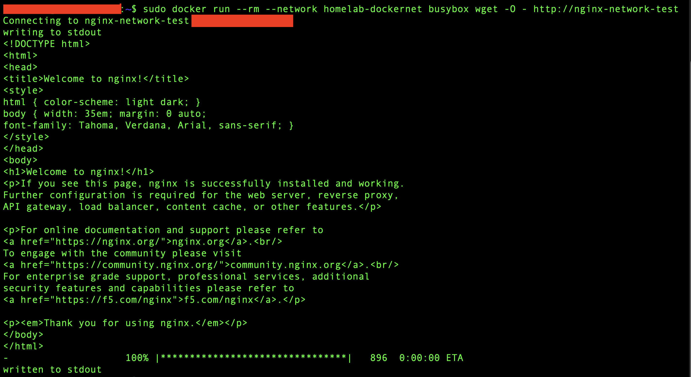
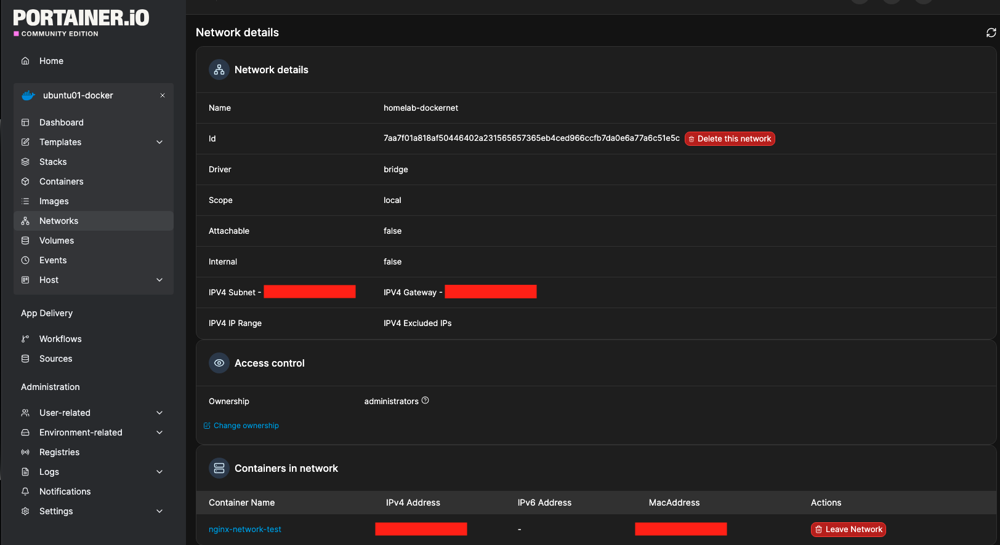
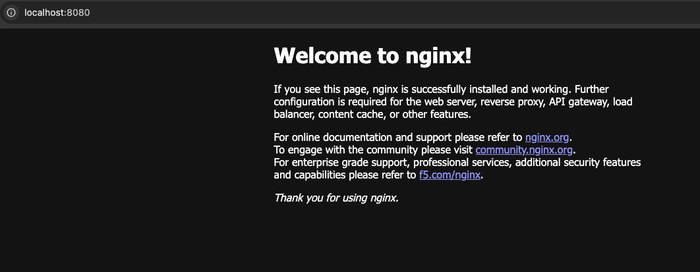
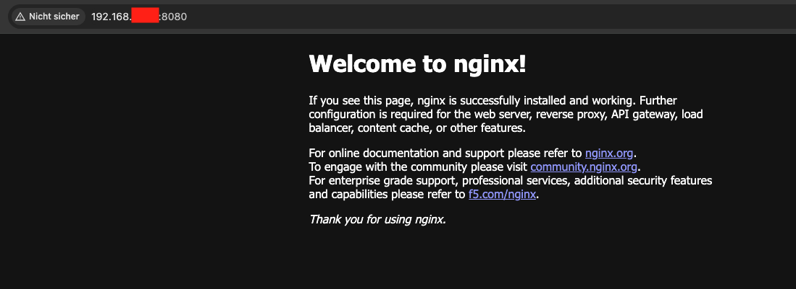
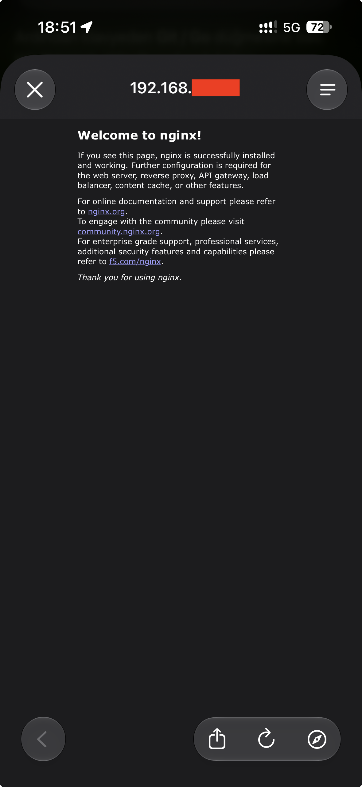
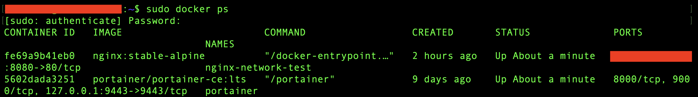

# Phase 3 – Docker Networking

> **Status:** ✅ Completed
>
> Part 4 – Docker & Containers

---

## Purpose & Objectives

The goal of this phase was to work with Docker networks, container name resolution, and published ports.

I used Nginx to test communication between containers and access from the LAN and through WireGuard. I also investigated a firewall issue and verified that the configuration worked after rebooting Ubuntu.

---

## Environment

| Component | Detail |
|:---|:---|
| Docker host | `ubuntu01` – Ubuntu Server |
| Container management | Docker CLI and Portainer CE |
| Docker network | `homelab-dockernet` – user-defined bridge |
| Web container | `nginx-network-test` |
| Web image | `nginx:stable-alpine` |
| Test image | BusyBox |
| Published port | Ubuntu LAN IP, TCP `8080` → container TCP `80` |
| Remote access | SSH tunnel and WireGuard |
| Host firewall | nftables |

*Selected usernames and network addresses are hidden in the screenshots. Address placeholders are used below.*

---

## 1. Docker Network and Container Communication

I created a user-defined bridge network named `homelab-dockernet`. Docker assigned the subnet automatically.

```bash
sudo docker network create --driver bridge homelab-dockernet
```

I started Nginx on this network without publishing a host port. A temporary BusyBox container on the same network reached Nginx by its container name.

```bash
sudo docker run --rm --network homelab-dockernet busybox wget -O - http://nginx-network-test
```

The response contained the default Nginx page. This confirmed both name resolution and HTTP communication inside the Docker network.



I also checked the network in Portainer and confirmed that `nginx-network-test` was connected.



### DNS Observation

An earlier BusyBox `nslookup` test returned `NXDOMAIN` for a name with the host's DNS search domain appended. A query with a trailing dot resolved the container name successfully:

```bash
sudo docker run --rm --network homelab-dockernet busybox nslookup nginx-network-test.
```

The HTTP test worked with the plain container name. No DNS configuration changes were needed.

---

## 2. Published Port and SSH Tunnel

I recreated the Nginx test container with port `8080` published on Ubuntu's LAN address.

```bash
sudo docker run -d --name nginx-network-test --network homelab-dockernet -p <UBUNTU_LAN_IP>:8080:80 nginx:stable-alpine
```

The published endpoint returned `HTTP/1.1 200 OK` when tested from Ubuntu. However, the same request from the MacBook timed out.

I then tested access through an SSH tunnel. The Nginx page opened at `http://localhost:8080` on the MacBook. No firewall rules were changed for this tunnel test.



---

## 3. Firewall Troubleshooting and LAN Access

I compared the successful request from Ubuntu with the failed request from the LAN and reviewed the active nftables rules.

Docker had created the port forwarding rules, but my own `inet filter forward` chain had a default drop policy. It did not allow new connections from the LAN to the custom Docker bridge.

I added a forwarding rule limited to:

- Traffic arriving from the LAN interface and LAN subnet.
- Traffic going to the `homelab-dockernet` bridge.
- Connections that had passed through destination NAT.
- TCP port `80` on the container side.

The rule used port `80` because Docker had already translated the published port `8080` before the packet reached the forward filter.

After this change, the MacBook reached Nginx directly through Ubuntu's LAN address.



---

## 4. WireGuard Access

The existing VPN allowed access to Proxmox, but Nginx was initially unreachable through WireGuard.

I added a similar forwarding rule for traffic arriving on `wg0` from the WireGuard subnet and going to the Docker bridge. It allowed destination-NAT connections to container TCP port `80`.

I disabled Wi-Fi on the iPhone, enabled WireGuard, and opened Nginx through Ubuntu's LAN address using mobile data. The page loaded successfully without an SSH tunnel.



---

## 5. Persistence and Reboot Verification

I backed up `/etc/nftables.conf` and added both forwarding rules to its existing forward chain. I checked the syntax before loading the file:

```bash
sudo nft -c -f /etc/nftables.conf
sudo nft -f /etc/nftables.conf
```

The file manages only my own firewall tables. Docker-managed tables were not copied into it or flushed.

I confirmed that the nftables service was enabled and configured Nginx to restart automatically:

```bash
sudo docker update --restart unless-stopped nginx-network-test
```

After rebooting Ubuntu, I verified access from both the MacBook on the LAN and the iPhone through WireGuard. Nginx and Portainer were running.



---

## Lessons Learned

- Container-to-container access and access through a published host port follow different network paths.
- A successful local request does not prove that LAN or VPN access works.
- Docker's forwarding rules must also work with the host's existing firewall policy.
- SSH tunnel access is useful for testing, but it does not verify direct LAN or WireGuard access.
- Saving firewall rules and setting a restart policy both matter for recovery after a reboot.

---

## Result

The custom Docker network and Nginx test container remain in place. Container-name access, SSH tunnel access, direct LAN access, and WireGuard access were verified.

The forwarding rules are persistent, and Nginx starts automatically after a reboot unless it was manually stopped. Portainer remains accessible through its existing SSH tunnel setup.

---

## References

Official documentation for the commands and settings used in this phase:

| Topic | Reference |
|:---|:---|
| Create, list, and inspect Docker networks | [Docker network commands](https://docs.docker.com/reference/cli/docker/network/) |
| Start containers with `--network`, `--rm`, and `-p` | [Docker run reference](https://docs.docker.com/reference/cli/docker/container/run/) |
| Publish ports on a specific host address | [Docker port publishing and mapping](https://docs.docker.com/engine/network/port-publishing/) |
| Configure `unless-stopped` and update restart policies | [Start containers automatically](https://docs.docker.com/engine/containers/start-containers-automatically/) |
| Inspect, check, and load firewall rules | [Ubuntu nftables documentation](https://documentation.ubuntu.com/security/security-features/network/firewall/nftables/) |
| Create an SSH tunnel with `-L` and `-N` | [OpenSSH command reference](https://man.openbsd.org/ssh) |

---

## Navigation

| Previous | Home | Next |
|:--------:|:----:|:----:|
| ⬅️ [Phase 2 – Docker Persistent Storage & Portainer](../2-Docker-Persistent-Storage-Portainer/README.md)| 🏠 [Home](../../README.md) | ➡️ Phase 4 – Docker Compose ***Coming Soon***|
