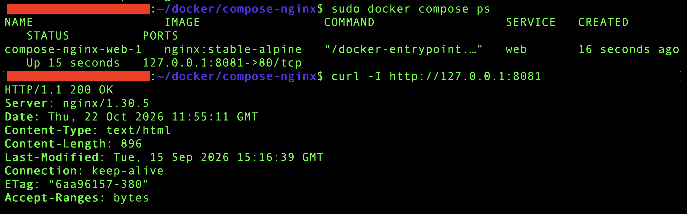
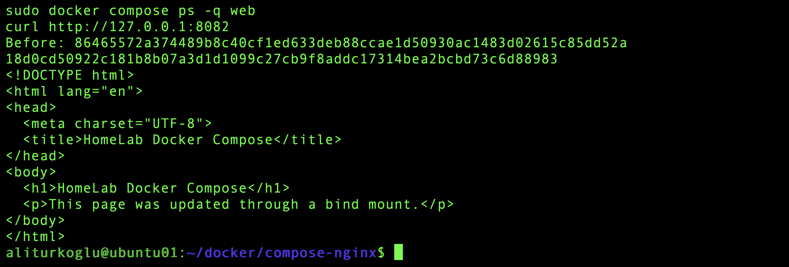
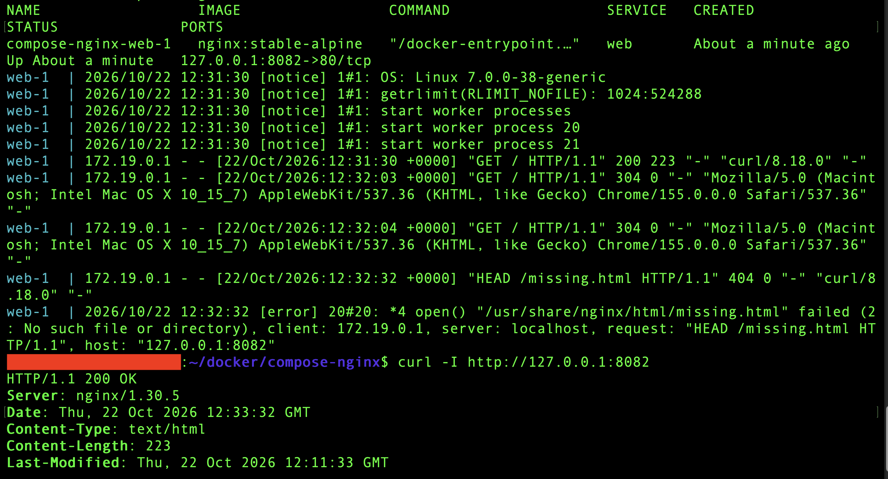

# Phase 4 – Docker Compose

> Part 4 – Docker & Containers  
> **Status:** ✅ Completed

I used Docker Compose to manage an Nginx service on `ubuntu01`. I moved the container settings into a Compose file, worked with variables, and checked what happens when a container is recreated.

## Environment

| Component | Detail |
|---|---|
| Host | `ubuntu01` – Ubuntu Server VM on Proxmox |
| Docker Compose | v5.6.0 |
| Image | `nginx:stable-alpine` |
| Service | `web` |
| Final published port | `127.0.0.1:8082 → 80/tcp` |
| Web content | Local `html` directory, mounted read-only |

## Managing Nginx with Compose

I created `compose.yaml` with Nano in `~/docker/compose-nginx`. The file kept the image, port, and storage settings together instead of using a long `docker run` command.

I checked the configuration with `docker compose config` before starting the service. Compose created the container `compose-nginx-web-1` and the network `compose-nginx_default`.

The first HTTP test returned `200 OK` on port `8081`.



The final Compose configuration was:

```yaml
services:
  web:
    image: nginx:stable-alpine
    ports:
      - "127.0.0.1:${WEB_PORT}:80"
    volumes:
      - "./html:/usr/share/nginx/html:ro"
    environment:
      LAB_ENV: ${LAB_ENV}
```

## Bind Mount and Variables

I created a simple `html/index.html` page on Ubuntu and mounted the directory into Nginx. After editing the page on the host, the updated text appeared without restarting the container. The `ro` option allowed the container to read the files without changing them.

The published port was bound to localhost. I tested it with `curl` on Ubuntu and used an SSH tunnel to view the page from my MacBook.

I stored these values in `.env`:

```dotenv
WEB_PORT=8082
LAB_ENV=homelab
```

`WEB_PORT` supplied the host port in the Compose file. I also passed `LAB_ENV` into the container through the `environment` section and checked it with `printenv`. This was a test variable; Nginx did not use it to change its behaviour.

## Container Recreation and Service Management

I changed `WEB_PORT` from `8081` to `8082` and applied the change with `docker compose up -d`. The container ID changed, and the updated HTML page was still available through the bind mount.



I also tested `stop` and `start`. The container changed from `Exited` to `Up`. With `down`, Compose removed the project's container and default network. Running `up -d` created them again, while the HTML files on Ubuntu remained available.

## Checking an HTTP 404

I requested `/missing.html` to test a missing file. The container was still `Up`, but Nginx returned `404`. The error log showed that `/usr/share/nginx/html/missing.html` did not exist.

The request reached Nginx successfully. The cause was the missing file, so no network or port change was needed. A final request to the main page returned `200 OK`.



## Commands Used

I ran the Compose commands from the project directory.

| Command | Use in this phase |
|---|---|
| `docker compose version` | Check the Compose version |
| `nano compose.yaml` / `nano .env` | Edit the configuration files |
| `sudo docker compose config` | Validate the configuration and check resolved values |
| `sudo docker compose up -d` | Create, start, or update the service in the background |
| `sudo docker compose ps` | Check status and published ports |
| `sudo docker compose ps -a` | Include stopped containers |
| `sudo docker compose ps -q web` | Read the container ID |
| `sudo docker compose exec web printenv LAB_ENV` | Check the variable inside the container |
| `sudo docker compose stop` / `sudo docker compose start` | Stop and start the existing container |
| `sudo docker compose down` | Remove the project's container and default network |
| `sudo docker compose logs --tail 10 web` | Read the last ten log lines |
| `curl -I http://127.0.0.1:8082` | Check the HTTP response headers |
| `curl http://127.0.0.1:8082` | Read the HTML response |

## Result

The Nginx settings are now stored in a reusable Compose file. I verified configuration changes, variables, service management, and persistent web content. I also used the logs to distinguish a missing file from a connection problem.

## References

- [How Compose works](https://docs.docker.com/compose/intro/compose-application-model/)
- [Compose file: services, ports, volumes, and environment](https://docs.docker.com/reference/compose-file/services/)
- [Variables and .env files](https://docs.docker.com/compose/how-tos/environment-variables/variable-interpolation/)
- [Setting environment variables inside containers](https://docs.docker.com/compose/how-tos/environment-variables/set-environment-variables/)
- [Bind mounts](https://docs.docker.com/engine/storage/bind-mounts/)
- [Compose CLI reference and command list](https://docs.docker.com/reference/cli/docker/compose/)
- [Configuration validation](https://docs.docker.com/reference/cli/docker/compose/config/)
- [Starting and recreating services](https://docs.docker.com/reference/cli/docker/compose/up/)
- [Stopping and removing services](https://docs.docker.com/reference/cli/docker/compose/down/)
- [Reading service logs](https://docs.docker.com/reference/cli/docker/compose/logs/)
- [curl command reference](https://curl.se/docs/manpage.html)

---
## Navigation

| Previous | Home | Next |
|:--------:|:----:|:----:|
| ⬅️ [Phase 3 – Docker Networking](../3-Docker-Networking/README.md)| 🏠 [Home](../../README.md) | ➡️ Phase 5 – GLPI Ticket System with Docker Compose - ***Coming Soon***|
