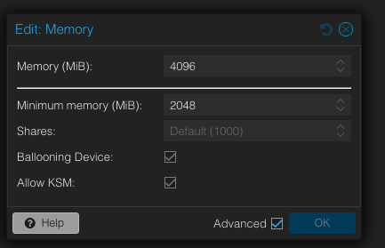
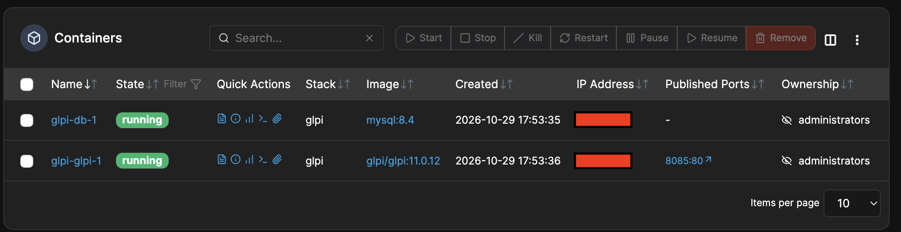
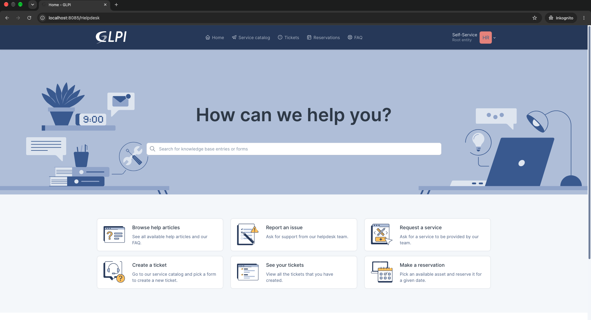
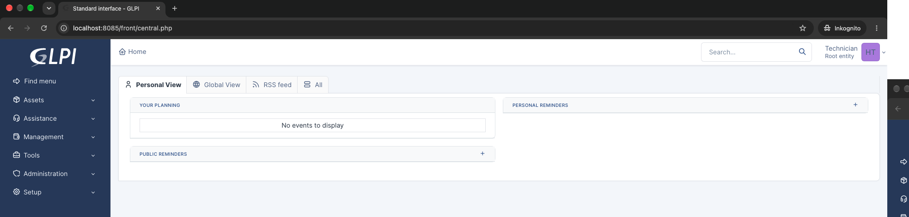
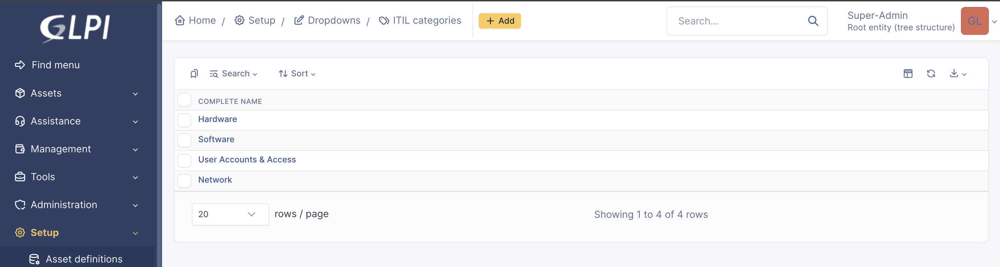
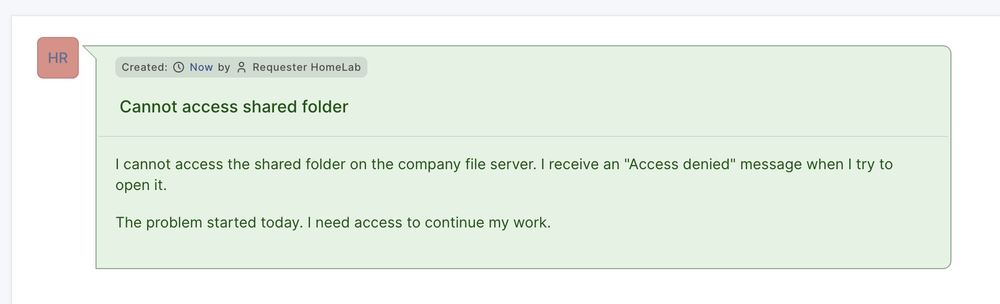
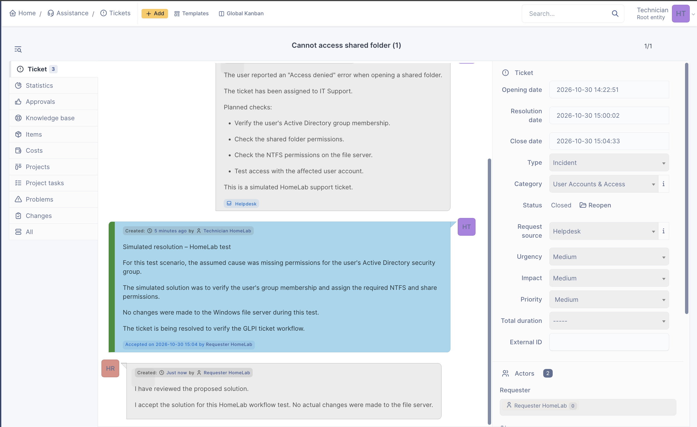
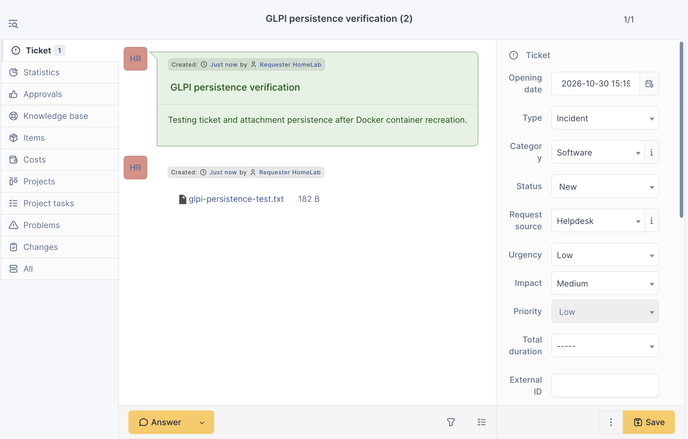
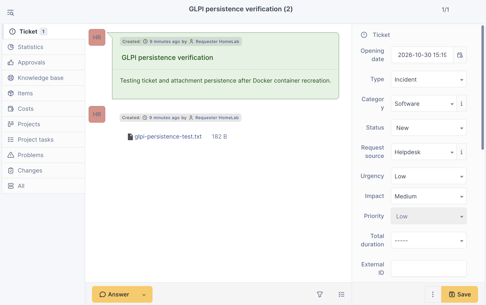

# Phase 5 – GLPI Ticket System

> **Status:** ✅ Completed

## Purpose & Objectives

In this phase, I deployed GLPI as a small IT helpdesk system using Docker Compose and Portainer. I wanted to work with a real ticket workflow, not only run another container.

My main goals were to:

- Deploy GLPI and MySQL as a multi-container application.
- Store application files and database data outside the containers.
- Set up separate requester and technician accounts.
- Work through a ticket from creation to closure.
- Test data persistence, automatic startup, backups, and network access.

## Environment

| Component | Configuration |
|---|---|
| Hypervisor | Proxmox VE |
| Server | Ubuntu Server 26.04.1 LTS VM |
| VM resources | 2 vCPU, 2–4 GiB RAM with ballooning |
| Container platform | Docker Engine, Docker Compose, Portainer |
| Application | GLPI `11.0.12` |
| Database | MySQL `8.4` |
| Data storage | Separate filesystem mounted at `/srv/data` |
| Access | Home LAN and WireGuard VPN |

Before deployment, I checked the available memory and adjusted the Ubuntu VM to use Proxmox memory ballooning. The VM can use more RAM when needed without keeping the full 4 GiB allocated all the time.



## Architecture

GLPI and MySQL run in the same Docker Compose stack and communicate over a private Docker network.

GLPI is accessible from the LAN and through WireGuard VPN. MySQL has no published host port.

Both services use bind mounts under `/srv/data/glpi/` to keep their data outside the containers.

## Deployment & Configuration

I created a `glpi` stack in **Portainer → Stacks → Add stack → Web editor**. I used the official GLPI Docker image and MySQL 8.4.

The Compose configuration used in this phase is shown below with the server IP hidden. Replace `SERVER_LAN_IP` with the server’s LAN IP in a local deployment:

```yaml
services:
  glpi:
    image: glpi/glpi:11.0.12
    restart: unless-stopped
    ports:
      - "SERVER_LAN_IP:8085:80"
    environment:
      GLPI_DB_HOST: db
      GLPI_DB_PORT: "3306"
      GLPI_DB_NAME: glpi
      GLPI_DB_USER: glpi
      GLPI_DB_PASSWORD: ${GLPI_DB_PASSWORD}
      GLPI_SKIP_AUTOUPDATE: "true"
    volumes:
      - /srv/data/glpi/files:/var/glpi
    depends_on:
      - db

  db:
    image: mysql:8.4
    restart: unless-stopped
    environment:
      MYSQL_RANDOM_ROOT_PASSWORD: "yes"
      MYSQL_DATABASE: glpi
      MYSQL_USER: glpi
      MYSQL_PASSWORD: ${GLPI_DB_PASSWORD}
    volumes:
      - /srv/data/glpi/mysql:/var/lib/mysql
```

I set `GLPI_DB_PASSWORD` in the Portainer stack environment variables instead of writing a password in the Compose file. No credentials are stored in this repository. I also changed the GLPI administrator password, disabled unused default user accounts, and rotated the MySQL root password.

The two bind mounts keep GLPI files and MySQL data on the Ubuntu server. I checked the GLPI files directory ownership so the container could write to it (UID/GID `33`). Both services use `unless-stopped` so they start again after a normal host reboot.



## Helpdesk Configuration

I created two test users with different roles:

| User | GLPI profile | Purpose |
|---|---|---|
| `requester01` | Self-Service | Open tickets and review solutions |
| `technician01` | Technician | Manage assigned tickets and provide solutions |

I also created four ITIL categories to organize support requests: **Hardware**, **Software**, **Network**, and **User Accounts & Access**.

<details>
<summary>GLPI Roles and Categories – Screenshots</summary>

**Requester interface**



**Technician interface**



**ITIL categories**



</details>

## Ticket Workflow – Shared Folder Access

I used a simulated workplace incident: a user could not open a shared folder and received an **Access denied** message.

The requester created the ticket under **User Accounts & Access**. I assigned it to the technician account and added a follow-up with planned checks: Active Directory group membership, share permissions, and NTFS permissions.

I then added a **simulated solution**. The requester accepted it, and the ticket was closed. **No changes were made to the Windows file server during this test.**





This test covered the workflow from **New → Assigned → Solved → Closed**, including communication between the requester and technician.

## Data Persistence & Restart Tests

I created a second ticket named **GLPI persistence verification** and attached a small text file.

I recorded the GLPI container ID, recreated the GLPI container in Portainer, and checked the ID again. The container ID changed, but the ticket and attachment were still available. I downloaded the attachment to confirm that its content had been kept.

| Test | Result |
|---|---|
| Recreate GLPI container | Passed |
| Ticket still available | Passed |
| Attachment download after recreation | Passed |
| Ubuntu reboot and automatic container startup | Passed |
| Ticket and attachment after reboot | Passed |





The MySQL container was not deliberately recreated as part of this test. I checked data persistence through the GLPI container recreation and the host reboot.

## Backup Checks

I created two local backups on the Ubuntu server:

| Backup | Location |
|---|---|
| MySQL database dump | `/srv/data/backups/glpi/glpi-db.sql` |
| GLPI files archive | `/srv/data/backups/glpi/glpi-files.tar.gz` |

I used `mysqldump` for the database and `tar` for GLPI files. I reviewed the SQL dump structure and checked the compressed archive. Both backup files were restricted to the owner with file permissions `600`.

**Limitations:** I did not perform a full restore test. The backups also remain on the same physical HomeLab storage, so they do not protect against a complete disk failure. An external backup and a proper restore test are planned for the Linux Operations project.

## Network Access & Security

GLPI was initially available through an SSH tunnel. I later published it on the Ubuntu server’s LAN address (TCP 8085) to make access easier for test users. The actual IP address is not included in this public repository.

I reviewed Docker port publishing and the existing nftables rules, then added forwarding rules for GLPI traffic from the trusted LAN and WireGuard subnet. Portainer still uses an SSH tunnel, and MySQL remains available only inside the Docker network.

| Connection test | Result |
|---|---|
| GLPI from the home LAN | HTTP 200 OK |
| GLPI through WireGuard | HTTP 200 OK |
| GLPI through mobile hotspot without VPN | Connection timed out |
| SSH through mobile hotspot without VPN | Connection timed out |

These results confirm the tested access paths. They are not a complete external security audit. No router port forwarding was added for GLPI.

This HomeLab currently uses HTTP on the trusted LAN and through WireGuard. HTTPS is a possible later improvement.

## Troubleshooting – Unexpected Remote Access

During testing, GLPI and SSH were reachable while my MacBook was connected to an iPhone hotspot. I initially thought WireGuard was disabled.

I checked the network route and found that traffic was still using the WireGuard interface (`utun6`). The VPN had probably reconnected automatically because of its On-Demand settings.

After disabling WireGuard again, I tested both services. GLPI (TCP 8085) and SSH (TCP 22) timed out. This showed that the tested mobile connection could not reach them without the VPN.

## Useful Commands

`SERVER_LAN_IP` is a placeholder. Use the real LAN IP only in your local configuration and terminal.


| Command | Purpose |
|---|---|
| `sudo docker ps` | Check running containers and published ports |
| `sudo docker stats --no-stream` | Check container CPU and memory usage |
| `sudo docker inspect glpi-glpi-1 --format '{{.Id}}'` | Check whether a container was recreated |
| `free -h` | Check Ubuntu memory and swap |
| `curl -I http://SERVER_LAN_IP:8085` | Check GLPI HTTP response |
| `sudo nft list chain inet filter forward` | Review the active firewall forwarding rules |
| `route -n get SERVER_LAN_IP` | Check the network path on macOS |

## Lessons Learned

- A multi-container application needs both a working database connection and persistent storage.
- Recreating a container does not remove data stored outside it.
- A running service does not prove that network access is correctly restricted.
- Checking the actual network route is useful when VPN behavior is unexpected.
- A backup file is not the same as a tested recovery process.

## Result

GLPI and MySQL are running in a small Docker Compose stack managed through Portainer. I configured user roles and ITIL categories, completed a simulated support ticket, verified ticket and attachment persistence, created basic backups, and checked LAN and WireGuard access.

The setup is suitable for further HomeLab service-desk practice. Backup recovery and more advanced operational controls will be addressed in a later project.

## References

- [GLPI – Official Docker Images](https://github.com/glpi-project/docker-images)
- [GLPI – Ticket Life Cycle](https://help.glpi-project.org/documentation/modules/assistance/tickets/ticketlifecycle)
- [GLPI – ITIL Categories](https://help.glpi-project.org/documentation/modules/configuration/dropdowns/categories)
- [Portainer – Add a Stack](https://docs.portainer.io/user/docker/stacks/add)
- [Portainer – Edit a Stack](https://docs.portainer.io/user/docker/stacks/edit)
- [Docker – Bind Mounts](https://docs.docker.com/engine/storage/bind-mounts/)
- [Docker – Port Publishing](https://docs.docker.com/engine/network/port-publishing/)
- [Docker – Packet Filtering and Firewalls](https://docs.docker.com/engine/network/packet-filtering-firewalls/)
- [MySQL 8.4 – mysqldump](https://dev.mysql.com/doc/refman/8.4/en/mysqldump.html)

---
## Navigation

| Previous | Home | Next |
|:--------:|:----:|:----:|
| ⬅️ [Phase 4-Docker-Compose](../4-Docker-Compose/README.md)| 🏠 [Home](../../README.md) | ➡️ Next Project (Planned) - IT Support & Troubleshooting Lab|

